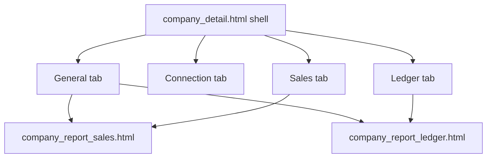

# Company detail — Pearl kit Implementation Plan

> **For agentic workers:** REQUIRED SUB-SKILL: Use superpowers:subagent-driven-development (recommended) or superpowers:executing-plans to implement this plan task-by-task. Steps use checkbox (`- [ ]`) syntax for tracking.

**Spec:** docs/superpowers/specs/2026-10-16-company-detail-design.md

# Company detail — Pearl kit (full page)

**Goal:** Put `company_detail` on the Pearl kit end-to-end: shell, General, Connection, and Sales/Ledger (including shared report partials), without changing URLs, GET/POST contracts, or htmx behavior.

**Approach (approved):** One feature branch, four SDD tasks. Spec will be written to `docs/superpowers/specs/2026-10-16-company-detail-design.md` at execution start (design already approved in chat), then this plan drives SDD.

**Reference:** [`templates/employees/employee_detail.html`](templates/employees/employee_detail.html), prior companies kit work on main.

## Global constraints

- Never touch `db.sqlite3`; probe only via `probe_settings`.
- Never remove displayed info/actions (Layan/Sky links, all KPI cards, columns, mobile cards).
- Keep: `?tab=`, `partial=sales|ledger`, `hx-vals` on `#company-sales-grid` / `#company-ledger-grid`, ids (`cr-period-from`, `cr-sales-q`, …), submit names `dep-submit` / `adj-submit` (prefix `dep`/`adj`), connection POST URLs.
- Colours from `--rd-*` only; no `--bs-*` inline backgrounds; no new `text-bg-*` / `btn-outline-warning`.
- Connection hard-coded Arabic → `` / gettext with Arabic `msgstr` matching current pinned strings (tests keep passing under Arabic).
- Shrink-only `LEGACY_*` in [`core/tests_ui_conventions.py`](core/tests_ui_conventions.py): remove `company_detail.html`, `company_detail_general.html`, `company_detail_connection.html`, `company_report_sales.html` (INLINE_WIDTH) when clean.
- Messages via Django messages → toasts; no new page-level success alert loops.
- Full suite before finish; screenshots 375/1280 light/dark under `.superpowers/companies-2026-10-16/`.

## Architecture

Views/logic stay in [`companies/views.py`](companies/views.py) `company_detail`, [`companies/statement.py`](companies/statement.py), [`companies/connection.py`](companies/connection.py) — templates + light form widget polish only unless a pin forces a tiny glue change.

## SDD tasks

### Task 1 — Shell + tabs
- Files: [`templates/companies/company_detail.html`](templates/companies/company_detail.html), locale, LEGACY_PAGE_HEAD.
- `rd-page` + `rd_page_header` (name, subtitle, back to list); keep Edit + conditional reconcile links.
- Keep `rd-section-tabs` and all tab href/`querystring` behaviour; tab label Connection via ``.
- Preserve sales/ledger wrapper grids and `hx-vals` exactly.
- Tests: extend kit assertions; existing `test_company_detail_renders_tabs` stays green.

### Task 2 — General tab
- Files: [`templates/companies/partials/company_detail_general.html`](templates/companies/partials/company_detail_general.html), optional small `PeriodFilterForm` in [`companies/forms.py`](companies/forms.py) if `rd_filter_card` needs it; LEGACY_LABEL_TAG.
- Period filter → kit/`rd_filter_card` with same GET names; keep `cr-period-from` / `cr-period-to` ids.
- KPI cards → consistent `rd-stat` / existing card pattern; no metric removed.
- Deposit/adjustment: `rd_fields` on `deposit_form` / `adj_form`; buttons still `name="dep-submit"` / `adj-submit` value `1`; hidden `tab=general`.
- Embedded sales/ledger includes unchanged contracts.

### Task 3 — Connection tab
- Files: [`templates/companies/partials/company_detail_connection.html`](templates/companies/partials/company_detail_connection.html), [`companies/forms_connection.py`](companies/forms_connection.py), [`companies/connection.py`](companies/connection.py) message strings → gettext, locale, LEGACY_LABEL_TAG.
- Wrap UI + message strings for i18n; Arabic msgstr = current pinned text.
- Drop `--bs-body-bg` inline styles; use design tokens / `rd-*`.
- Keep write-only secrets; same form actions and test-login UX.
- Tests: [`companies/tests_connection.py`](companies/tests_connection.py) stay green (Arabic still rendered).

### Task 4 — Sales/Ledger partials
- Files: [`templates/reports/partials/company_report_sales.html`](templates/reports/partials/company_report_sales.html), [`templates/reports/partials/company_report_ledger.html`](templates/reports/partials/company_report_ledger.html), LEGACY_INLINE_WIDTH.
- Keep columns, sort links, pagination, sibling hidden fields, mobile cards, `hx-*` on filter forms.
- Remove `style="max-width: …"` → token/class.
- Screenshots of all four tabs; full `manage.py test`.

## Out of scope

- Dead `company_report.html` cleanup (inventory free win — separate tiny follow-up).
- Kit `force_escape` double-escape fix (parked from catalog final review).
- Changing reconcile pages.

## Execution

Worktree branch `pearl-company-detail` off `main`. SDD with implementer + task review per task; final branch review; finishing menu (merge/PR/keep).
