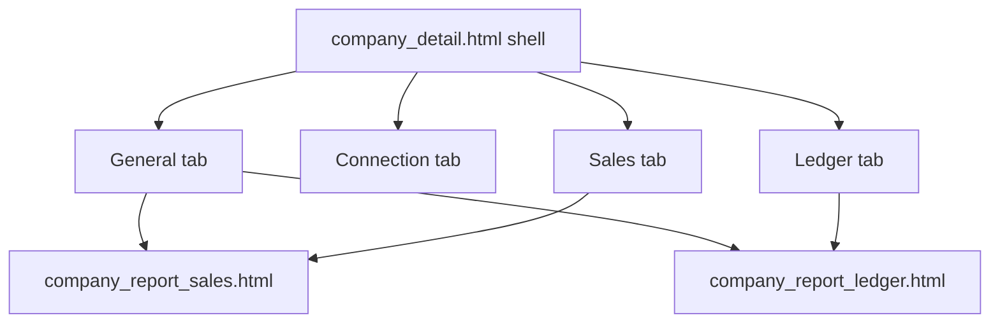

# Company detail — Pearl kit Implementation Plan

> **For agentic workers:** REQUIRED SUB-SKILL: Use superpowers:subagent-driven-development (recommended) or superpowers:executing-plans to implement this plan task-by-task. Steps use checkbox (`- [ ]`) syntax for tracking.

**Spec:** docs/superpowers/specs/2026-10-16-company-detail-design.md

# Company detail — Pearl kit (full page)

**Goal:** Put `company_detail` on the Pearl kit end-to-end: shell, General, Connection, and Sales/Ledger (including shared report partials), without changing URLs, GET/POST contracts, or htmx behavior.

**Approach (approved):** One feature branch, four SDD tasks. Spec will be written to `docs/superpowers/specs/2026-10-16-company-detail-design.md` at execution start (design already approved in chat), then this plan drives SDD.

**Reference:** [`templates/employees/employee_detail.html`](templates/employees/employee_detail.html), prior companies kit work on main.

## Global constraints

- Never touch `db.sqlite3`; probe only via `probe_settings`.
- Never remove displayed info/actions (Layan/Sky links, all KPI cards, columns, mobile cards).
- Keep: `?tab=`, `partial=sales|ledger`, `hx-vals` on `#company-sales-grid` / `#company-ledger-grid`, ids (`cr-period-from`, `cr-sales-q`, …), submit names `dep-submit` / `adj-submit` (prefix `dep`/`adj`), connection POST URLs.
- Colours from `--rd-*` only; no `--bs-*` inline backgrounds; no new `text-bg-*` / `btn-outline-warning`.
- Connection hard-coded Arabic → `` / gettext with Arabic `msgstr` matching current pinned strings (tests keep passing under Arabic).
- Shrink-only `LEGACY_*` in [`core/tests_ui_conventions.py`](core/tests_ui_conventions.py): remove `company_detail.html`, `company_detail_general.html`, `company_detail_connection.html`, `company_report_sales.html` (INLINE_WIDTH) when clean.
- Messages via Django messages → toasts; no new page-level success alert loops.
- Full suite before finish; screenshots 375/1280 light/dark under `.superpowers/companies-2026-10-16/`.

## Architecture

Views/logic stay in [`companies/views.py`](companies/views.py) `company_detail`, [`companies/statement.py`](companies/statement.py), [`companies/connection.py`](companies/connection.py) — templates + light form widget polish only unless a pin forces a tiny glue change.

## SDD tasks

### Task 1 — Shell + tabs

**Files:** `templates/companies/company_detail.html`, locale if needed, `core/tests_ui_conventions.py` (LEGACY_PAGE_HEAD).

**Interfaces:** `rd-page` + `rd_page_header` (company name, subtitle Supplier balance and sales, back to list); keep Edit + conditional Layan/Sky links; `rd-section-tabs` + existing `?tab=`/`querystring`; Connection tab label `` (or equivalent) with Arabic msgstr matching `الربط مع المزوّد`; preserve sales/ledger wrapper `hx-vals` exactly.

- [ ] **Step 1:** Write failing kit test(s) for company detail shell (`rd-page-head` / header) and Connection tab still showing Arabic under ar.
- [ ] **Step 2:** Run — expect FAIL.
- [ ] **Step 3:** Implement; remove `company_detail.html` from LEGACY_PAGE_HEAD.
- [ ] **Step 4:** `.venv/bin/python manage.py test companies core` (+ compilemessages -l ar if new msgid).
- [ ] **Step 5:** Commit `feat(companies): company detail shell and tabs on the page kit`

### Task 2 — General tab

**Files:** `templates/companies/partials/company_detail_general.html`, optional `PeriodFilterForm` in `companies/forms.py`, view context glue if needed, LEGACY_LABEL_TAG, locale.

**Interfaces:** Period filter via kit/`rd_filter_card` with GET `period_from`/`period_to` + hidden `tab=general`; keep ids `cr-period-from`/`cr-period-to`. All KPI metrics retained (`rd-stat` ok). Deposit/adjustment via `rd_fields`; buttons `dep-submit`/`adj-submit` value `1`. Embedded grids keep `hx-vals` with `tab=general`.

- [ ] **Step 1:** Failing tests for kit filter/forms, submit names, KPI labels present.
- [ ] **Step 2:** Run — expect FAIL.
- [ ] **Step 3:** Implement; shrink LEGACY_LABEL_TAG for general partial.
- [ ] **Step 4:** `manage.py test companies core reports`.
- [ ] **Step 5:** Commit `feat(companies): company detail general tab on the page kit`

### Task 3 — Connection tab

**Files:** `templates/companies/partials/company_detail_connection.html`, `companies/forms_connection.py`, `companies/connection.py`, locale, LEGACY_LABEL_TAG.

**Interfaces:** All UI + flash strings gettext/`` with Arabic msgstr = current pinned text. No `--bs-body-bg` inline. Write-only secrets; same POST actions. `tests_connection.py` stays green.

- [ ] **Step 1:** Confirm RED only if new assertions; otherwise implement against existing connection tests.
- [ ] **Step 2:** Implement i18n + token cleanup; shrink LEGACY for connection partial.
- [ ] **Step 3:** `manage.py test companies.tests_connection companies core` + `compilemessages -l ar`.
- [ ] **Step 4:** Commit `feat(companies): company detail connection tab i18n and kit cleanup`

### Task 4 — Sales/Ledger partials

**Files:** `templates/reports/partials/company_report_sales.html`, `company_report_ledger.html`, LEGACY_INLINE_WIDTH.

**Interfaces:** Keep columns, sort, pagination, sibling hiddens, mobile cards, `hx-*`. Remove inline `max-width` styles. Screenshots all four tabs; full suite.

- [ ] **Step 1:** Failing test: sales partial has no `style="…max-width`.
- [ ] **Step 2:** Implement; shrink LEGACY_INLINE_WIDTH.
- [ ] **Step 3:** Screenshots to `.superpowers/companies-2026-10-16/`; `manage.py test`.
- [ ] **Step 4:** Commit `feat(companies): company sales and ledger grids kit cleanup`

## Out of scope

- Dead `company_report.html` cleanup (inventory free win — separate tiny follow-up).
- Kit `force_escape` double-escape fix (parked from catalog final review).
- Changing reconcile pages.

## Execution

Worktree branch `pearl-company-detail` off `main`. SDD with implementer + task review per task; final branch review; finishing menu (merge/PR/keep).
